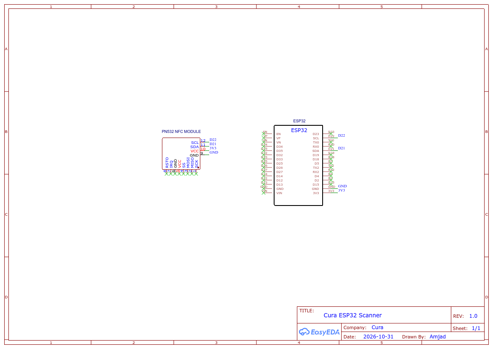

<p align="center">
  
</p>

<h1 align="center">Cura. HMS</h1>

<p align="center">
  <b>Enterprise Hospital Management Information System with Dual-Mode Physical &amp; Digital NFC Card Integration</b>
</p>

<p align="center">
  
  
  
  
  
  
</p>

> **Executive Summary:**  
> Cura. HMS is an end-to-end clinical hospital management system engineered to modernize healthcare administration. Featuring an Apple-inspired Liquid Glass user interface, asynchronous microservices architecture, and browser-native dual-mode RFID/NFC hardware connectivity, Cura eliminates manual terminal input by enabling immediate patient identification via physical MyKad/CUID smart cards and Android Host Card Emulation (HCE).

---

## 📑 Language Options / Pilihan Bahasa
* 🇬🇧 **[English Documentation (Current)](README.md)**
* 🇲🇾 **[Dokumentasi Bahasa Melayu](README_MY.md)**

---

## 🏛️ High-Level System Architecture

```text
┌────────────────────────────────────────────────────────────────────────────────────────┐
│                                   CLIENT TIERS & SENSORS                               │
├──────────────────────────────────────┬─────────────────────────────────────────────────┤
│           DESKTOP WORKSTATION        │                  MOBILE CLIENTS                 │
│      Google Chrome / Edge (Blink)    │       Android Chrome       │ Android Smartphone │
│         Web Serial API (USB)         │       Web NFC (NDEF)       │ Flutter (cura_app) │
└──────────────────┬───────────────────┴──────────────┬─────────────┴──────────┬─────────┘
                   │                                  │                        │
                   ▼ (115200 Baud CDC)                ▼ (Direct Tag Poll)      │ HCE APDU
┌──────────────────────────────────────┐              │                        │ (AID F222222222)
│      ESP32-S3 EMBEDDED CONTROLLER    │              │                        │
│   Native USB CDC + HID Keyboard      │              │                        ▼
│      I2C Bus (SDA: GPIO8, SCL: GPIO9)│              │               ┌──────────────────┐
│                    │                 │              │               │ PN532 Transceiver│
│                    ▼                 │              │               │ (ISO-DEP Reader) │
│       Adafruit PN532 Transceiver     │              │               └────────┬─────────┘
│   (Mifare CUID Gen1a/2 Block 0 Write)│              │                        │
└──────────────────┬───────────────────┘              │                        │
                   │ Raw UID / Token Stream           │                        │
                   ▼                                  ▼                        │
┌──────────────────────────────────────────────────────────────────────────────┴─────────┐
│                             REVERSE PROXY & SECURITY LAYER                             │
│       Nginx Proxy Manager / Frontend Gateway (Port 80/8087) + Strict Permissions       │
└──────────────────────────────────────┬─────────────────────────────────────────────────┘
                                       │ REST API (JSON / Axios)
                                       ▼
┌────────────────────────────────────────────────────────────────────────────────────────┐
│                               FASTAPI BACKEND SERVICES                                 │
│  FastAPI (Python 3.12, Uvicorn) • Request-ID Tracing • CORS • Async SQLAlchemy 2.0     │
│   Auth • Patients • Doctors • Pharmacy • Laboratory • Clinical Records • Operations    │
└──────────────────────────────────────┬─────────────────────────────────────────────────┘
                                       │ Asyncpg Pool (Internal DNS: cura_db:5432)
                                       ▼
┌────────────────────────────────────────────────────────────────────────────────────────┐
│                                   PERSISTENT DATABASE                                  │
│               PostgreSQL 16 Engine • UUID Primary Keys • Asia/Kuala_Lumpur             │
└────────────────────────────────────────────────────────────────────────────────────────┘
```

---

## 🔌 Hardware Circuit & Wiring Schematic

The terminal scanning station utilizes an **ESP32-S3 Dev Module** interfaced with an **Adafruit PN532 NFC/RFID transceiver module** over native I2C.

<p align="center">
  
</p>

* 📄 **Download Printable Schematic PDF:** [`Schematic_cura_2026-10-31.pdf`](Schematic_cura_2026-10-31.pdf)
* 📄 **Detailed Wiring & Pinout Guide:** [`esp32_nfc/PINOUT_AND_WIRING.md`](esp32_nfc/PINOUT_AND_WIRING.md)
* 📄 **Firmware Flashing Guide:** [`esp32_nfc/FLASHING_AND_SETUP.md`](esp32_nfc/FLASHING_AND_SETUP.md)

---

## 📌 Hardware Pinout Table

| ESP32-S3 MCU Pin | PN532 Module Pin | Signal Description | Electrical Specifications |
|:----------------:|:----------------:|:------------------|:-------------------------|
| **GPIO 8** | `SDA` | I2C Serial Data Bus | 3.3V Logic Level (Internal Pull-Up) |
| **GPIO 9** | `SCL` | I2C Serial Clock Bus | 3.3V Logic Level (Internal Pull-Up) |
| **GPIO 4** | `IRQ` | Hardware Interrupt Request | Active-Low Digital Signal |
| **GPIO 5** | `RSTPD_N` (RST) | Hardware Reset Line | Active-Low Digital Output |
| **3.3V** / **5V** | `VCC` | Module Main Power Rail | 3.3V DC (Recommended) / 5.0V DC |
| **GND** | `GND` | Common Ground | 0V Reference |
| **USB D- (GPIO 19)** | Type-C USB Port | USB 2.0 Differential Data Negative | Full-Speed Native USB Controller |
| **USB D+ (GPIO 20)** | Type-C USB Port | USB 2.0 Differential Data Positive | Full-Speed Native USB Controller |

*Important DIP Switch Setting:* Set PN532 hardware switches to **I2C Mode** (`SEL0 = 1 (High)`, `SEL1 = 0 (Low)`).

---

## 🚀 Key Features & Algorithmic Highlights

1. **Dual-Mode Identification Architecture:**
   - **Physical Smart Cards:** Scans standard 4-byte Mifare UID, CUID cards, and Malaysian Government MyKad RFID chip UIDs (`CF289949`).
   - **Android Host Card Emulation (HCE):** Interacts with `cura_app` via custom ISO-DEP APDU commands (`SELECT AID F222222222`), retrieving virtual patient identification tokens directly from patient smartphones.
2. **CUID Block 0 Programming Engine:**
   - Universal block zero write routine executing Gen2 backdoor unlock commands with an automatic fallback to Gen1a APDU sequences (`0x40`, `0x43`).
   - Enables clinicians to write formatted patient identifiers (`C00A0001`) onto physical cards straight from the web browser via Web Serial.
3. **Deterministic Sequential ID Generation:**
   - Centralized backend ID generator (`core/idgen.py`) maintaining synchronous entity prefix spaces:
     - Patients: `C00A0001` - `C00A9999`
     - Medical Practitioners: `C01A0001` - `C01A9999`
     - Prescriptions: `C02A0001`, Lab: `C03A0001`, Vitals: `C04A0001`, Records: `C05A0001`
4. **Device-Aware Operational Gateway:**
   - Client-side runtime detection (`useDevice.js`) ensuring hardware capabilities match terminal operating systems (disabling serial triggers on mobile handsets and locking mobile-only Web NFC sensors on desktop browsers).
5. **Patient Re-Admission Lifecycle:**
   - Preserves patient medical history and hardware UID index integrity across multiple hospital stays without generating orphaned or duplicated records.

---

## 📂 Repository Structure Tree

```text
.
├── logo.svg                                # Vector project emblem
├── favicon.svg                             # Minimalist C. SVG favicon
├── favicon.ico                             # Multi-resolution desktop favicon
├── og-image.png                            # Social link preview banner (1200x630)
├── Schematic_cura_2026-10-31.png           # Hardware circuit wiring graphic
├── Schematic_cura_2026-10-31.pdf           # Vector schematic printable document
├── README.md                               # Primary system documentation (English)
├── README_MY.md                            # Primary system documentation (Bahasa Melayu)
├── LICENSE                                 # Educational usage agreement
│
├── cura_web/                               # CORE WEB APPLICATION (DOCKER)
│   ├── README.md                           # Web stack technical overview
│   ├── README_MY.md                        # Web stack technical overview (Bahasa Melayu)
│   ├── API_DOCUMENTATION.md                # Comprehensive REST API specifications
│   ├── API_DOCUMENTATION_MY.md             # REST API specifications (Bahasa Melayu)
│   ├── DOCKER_AND_SERVICES.md              # Container topology & deployment guide
│   ├── DOCKER_AND_SERVICES_MY.md           # Container deployment (Bahasa Melayu)
│   ├── SECURITY_AND_ARCHITECTURE.md        # Cryptography, auth & security architecture
│   ├── SECURITY_AND_ARCHITECTURE_MY.md     # Security architecture (Bahasa Melayu)
│   ├── docker-compose.yml                  # 3-tier microservice orchestration
│   ├── .env.example                        # Template environment configuration
│   │
│   ├── backend/                            # FASTAPI APPLICATION (PYTHON 3.12)
│   │   ├── Dockerfile                      # Async Python container runtime
│   │   ├── requirements.txt                # Pinned production dependencies
│   │   └── app/
│   │       ├── main.py                     # API entrypoint, migrations & lifespan
│   │       ├── core/                       # Database engine, security & middleware
│   │       ├── models/                     # SQLAlchemy ORM database schemas
│   │       ├── routers/                    # Domain endpoints (patients, doctors, etc.)
│   │       └── schemas/                    # Pydantic request/response validation models
│   │
│   └── frontend/                           # VUE 3 CLIENT DASHBOARD (VITE + NGINX)
│       ├── Dockerfile                      # Multi-stage production Nginx image
│       ├── nginx.conf                      # Gateway config & Web NFC permissions
│       ├── vite.config.js                  # Vite configuration & asset hashing
│       ├── index.html                      # Entry HTML with structured JSON-LD & meta
│       ├── public/                         # Static icons, robots.txt, sitemap, llms.txt
│       └── src/
│           ├── App.vue                     # Liquid glass layout shell & corner badge
│           ├── stores/                     # Pinia reactive state (serial, theme)
│           ├── composables/                # Reusable sensor & dialog hooks
│           ├── components/                 # Dual-mode scan bars & write buttons
│           └── views/                      # Clinical page components
│
├── cura_app/                               # PATIENT MOBILE APP (FLUTTER)
│   ├── README.md                           # Flutter HCE card emulator guide
│   ├── README_MY.md                        # Flutter HCE guide (Bahasa Melayu)
│   ├── lib/                                # Dart application source & UI widgets
│   └── android/                            # Native Kotlin HostApduService & AID config
│
└── esp32_nfc/                              # HARDWARE TERMINAL FIRMWARE
    ├── README.md                           # Embedded hardware system guide
    ├── README_MY.md                        # Hardware guide (Bahasa Melayu)
    ├── PINOUT_AND_WIRING.md                # Electrical pinout & schematic analysis
    ├── PINOUT_AND_WIRING_MY.md             # Electrical pinout (Bahasa Melayu)
    ├── FLASHING_AND_SETUP.md               # Toolchain installation & flashing guide
    ├── FLASHING_AND_SETUP_MY.md            # Toolchain guide (Bahasa Melayu)
    └── esp32_s3_scanner/
        └── esp32_s3_scanner.ino            # Dual-mode CUID + HCE Arduino C++ firmware
```

---

## ⚡ Quick Start Guide

### 1. Web Application Deployment (Docker)

Ensure Docker and Docker Compose are installed on your host system:

```bash
# Navigate to web root
cd cura_web

# Create production environment file from template
cp .env.example .env

# Build and start services
docker compose up --build -d
```

Access clinical terminals:
* **Web Dashboard:** `http://localhost:8087`
* **Interactive API Documentation:** `http://localhost:8800/docs`
* **Default Administrator:** `admin@mail.com` | `Password@123`

### 2. Hardware Flashing (ESP32-S3)

1. Open Arduino IDE and install the `Adafruit PN532` library.
2. Open `esp32_nfc/esp32_s3_scanner/esp32_s3_scanner.ino`.
3. Set **Tools $\rightarrow$ Board** to `ESP32S3 Dev Module`.
4. Set **Tools $\rightarrow$ USB CDC On Boot** to `Enabled`.
5. Connect your board via USB and upload the sketch.
6. Connect the terminal via Google Chrome / Edge on desktop and pair via **Settings $\rightarrow$ Connect Scanner**.

---

## 📜 License
* Developed for **Educational Purposes Only**.
