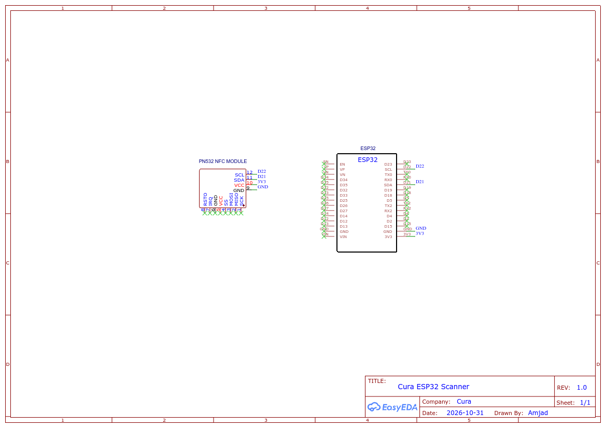

<p align="center">
  
</p>

<h1 align="center">Cura. HMS</h1>

<p align="center">
  <b>Sistem Pengurusan Maklumat Hospital dengan Integrasi Kad Pintar NFC Dwi-Mod (Fizikal &amp; Digital)</b>
</p>

<p align="center">
  
  
  
  
  
  
</p>

> **Ringkasan Eksekutif:**  
> Cura. HMS ialah sistem pengurusan hospital menyeluruh yang direka untuk memodenkan pentadbiran klinikal. Dilengkapi dengan antaramuka Liquid Glass bercirikan iOS, seni bina mikroservis tak segerak (asynchronous), dan sambungan perkakasan RFID/NFC dwi-mod terus dari pelayar web, Cura menghapuskan input manual kaunter dengan membolehkan pengecaman pesakit secara serta-merta melalui kad fizikal MyKad/CUID dan emulasi telefon pintar Android (Host Card Emulation).

---

## 📑 Pilihan Bahasa / Language Options
* 🇲🇾 **[Dokumentasi Bahasa Melayu (Semasa)](README_MY.md)**
* 🇬🇧 **[English Documentation](README.md)**

---

## 🏛️ Seni Bina Sistem Peringkat Tinggi

```text
┌────────────────────────────────────────────────────────────────────────────────────────┐
│                               LAPISAN KLIEN & SENSOR                                   │
├──────────────────────────────────────┬─────────────────────────────────────────────────┤
│            STESEN KERJA DESKTOP      │                 KLIEN MUDAH ALIH                │
│      Google Chrome / Edge (Blink)    │       Android Chrome       │ Telefon Pintar     │
│         Web Serial API (USB)         │       Web NFC (NDEF)       │ Flutter (cura_app) │
└──────────────────┬───────────────────┴──────────────┬─────────────┴──────────┬─────────┘
                   │                                  │                        │
                   ▼ (115200 Baud CDC)                ▼ (Imbas Tag Terus)      │ HCE APDU
┌──────────────────────────────────────┐              │                        │ (AID F222222222)
│     PENGAWAL TERTANAM ESP32-S3       │              │                        │
│   Native USB CDC + Papan Kekunci HID │              │                        ▼
│      Bas I2C (SDA: GPIO8, SCL: GPIO9)│              │               ┌──────────────────┐
│                    │                 │              │               │ Modul PN532      │
│                    ▼                 │              │               │ (Pembaca ISO-DEP)│
│          Modul Pemancar PN532        │              │               └────────┬─────────┘
│   (Tulis Blok 0 Mifare CUID Gen1a/2) │              │                        │
└──────────────────┬───────────────────┘              │                        │
                   │ Aliran UID / Token Mentah        │                        │
                   ▼                                  ▼                        │
┌──────────────────────────────────────────────────────────────────────────────┴─────────┐
│                           LAPISAN PROKSI REVERSE & KESELAMATAN                         │
│       Nginx Proxy Manager / Gerbang Frontend (Port 80/8087) + Kebenaran Ketat          │
└──────────────────────────────────────┬─────────────────────────────────────────────────┘
                                       │ REST API (JSON / Axios)
                                       ▼
┌────────────────────────────────────────────────────────────────────────────────────────┐
│                                 PERKHIDMATAN FASTAPI BACKEND                           │
│  FastAPI (Python 3.12, Uvicorn) • Request-ID Tracing • CORS • Async SQLAlchemy 2.0     │
│    Auth • Pesakit • Doktor • Farmasi • Makmal • Rekod Klinikal • Operasi & Gaji        │
└──────────────────────────────────────┬─────────────────────────────────────────────────┘
                                       │ Kolam Asyncpg (DNS Dalaman: cura_db:5432)
                                       ▼
┌────────────────────────────────────────────────────────────────────────────────────────┐
│                               PANGKALAN DATA KEKAL                                     │
│             Enjin PostgreSQL 16 • Kunci Utama UUID • Waktu Asia/Kuala_Lumpur           │
└────────────────────────────────────────────────────────────────────────────────────────┘
```

---

## 🔌 Litar Skematik & Sambungan Perkakasan

Stesen pengimbas kaunter menggunakan modul **ESP32-S3 Dev Module** yang disambungkan ke modul pemancar **Adafruit PN532 NFC/RFID** melalui protokol I2C.

<p align="center">
  
</p>

* 📄 **Muat Turun PDF Skematik Berkualiti Tinggi:** [`Schematic_cura_2026-10-31.pdf`](Schematic_cura_2026-10-31.pdf)
* 📄 **Panduan Sambungan Pin Lengkap:** [`esp32_nfc/PINOUT_AND_WIRING_MY.md`](esp32_nfc/PINOUT_AND_WIRING_MY.md)
* 📄 **Panduan Flashing Firmware:** [`esp32_nfc/FLASHING_AND_SETUP_MY.md`](esp32_nfc/FLASHING_AND_SETUP_MY.md)

---

## 📌 Jadual Sambungan Pin Perkakasan

| Pin MCU ESP32-S3 | Pin Modul PN532 | Keterangan Isyarat | Spesifikasi Elektrik |
|:----------------:|:---------------:|:-------------------|:---------------------|
| **GPIO 8** | `SDA` | Bas Data Bersiri I2C | Paras Logik 3.3V (Pull-Up Dalaman) |
| **GPIO 9** | `SCL` | Bas Jam Bersiri I2C | Paras Logik 3.3V (Pull-Up Dalaman) |
| **GPIO 4** | `IRQ` | Permintaan Gangguan Perkakasan | Isyarat Digital Aktif-Rendah (Active-Low) |
| **GPIO 5** | `RSTPD_N` (RST) | Talian Reset Perkakasan | Output Digital Aktif-Rendah |
| **3.3V** / **5V** | `VCC` | Bekalan Kuasa Utama Modul | 3.3V DC (Disyorkan) / 5.0V DC |
| **GND** | `GND` | Ground Sepunya | Rujukan 0V |
| **USB D- (GPIO 19)** | Port USB Type-C | Data Negatif Pembezaan USB 2.0 | Pengawal USB Asli Kelajuan Penuh |
| **USB D+ (GPIO 20)** | Port USB Type-C | Data Positif Pembezaan USB 2.0 | Pengawal USB Asli Kelajuan Penuh |

*Tetapan Suis DIP Penting:* Tetapkan suis perkakasan PN532 ke **Mod I2C** (`SEL0 = 1 (Tinggi)`, `SEL1 = 0 (Rendah)`).

---

## 🚀 Ciri-Ciri Utama & Algoritma Sistem

1. **Seni Bina Pengecaman Dwi-Mod:**
   - **Kad Pintar Fizikal:** Mengimbas UID 4-byte standard Mifare, kad CUID, serta UID cip perkakasan MyKad Jabatan Pendaftaran Negara Malaysia (`CF289949`).
   - **Emulasi Kad Android (HCE):** Berkomunikasi dengan aplikasi `cura_app` melalui arahan ISO-DEP APDU (`SELECT AID F222222222`), membaca token identiti pesakit digital terus dari telefon pintar.
2. **Enjin Pengaturcaraan Blok 0 CUID:**
   - Melaksanakan rutin tulis blok sifar universal (Gen2 backdoor unlock) dengan fallback automatik ke jujukan APDU Gen1a (`0x40`, `0x43`).
   - Membolehkan petugas kesihatan menulis ID pesakit (`C00A0001`) ke dalam kad fizikal terus dari pelayar web melalui Web Serial.
3. **Penjanaan ID Bersiri Deterministik:**
   - Penjana ID berpusat di backend (`core/idgen.py`) memastikan ruang awalan kekal segerak dan unik:
     - Pesakit: `C00A0001` - `C00A9999`
     - Pengamal Perubatan / Doktor: `C01A0001` - `C01A9999`
     - Preskripsi: `C02A0001`, Makmal: `C03A0001`, Tanda Vital: `C04A0001`, Rekod Perubatan: `C05A0001`
4. **Gerbang Operasi Peka-Peranti (Device-Aware):**
   - Pengesanan runtime pada klien (`useDevice.js`) memastikan sensor perkakasan sepadan dengan sistem operasi (menutup butang Web Serial di telefon dan mengunci penderia Web NFC di pelayar desktop).
5. **Kitaran Hayat Kemasukan Semula Pesakit (Re-Admission):**
   - Memelihara sejarah perubatan pesakit dan integriti indeks UID perkakasan merentasi pelbagai sesi kemasukan wad tanpa mencipta rekod pendua.

---

## 📂 Struktur Direktori Repositori

```text
.
├── logo.svg                                # Lambang vektor projek
├── favicon.svg                             # Favicon SVG minimalist C.
├── favicon.ico                             # Favicon desktop pelbagai resolusi
├── og-image.png                            # Banner pratonton media sosial (1200x630)
├── Schematic_cura_2026-10-31.png           # Gambar rajah pendawaian litar perkakasan
├── Schematic_cura_2026-10-31.pdf           # Dokumen skematik vektor sedia cetak
├── README.md                               # Dokumentasi utama sistem (Bahasa Inggeris)
├── README_MY.md                            # Dokumentasi utama sistem (Bahasa Melayu)
├── LICENSE                                 # Perjanjian kegunaan akademik
│
├── cura_web/                               # APLIKASI WEB UTAMA (DOCKER)
│   ├── README.md                           # Ringkasan teknikal web stack (Bahasa Inggeris)
│   ├── README_MY.md                        # Ringkasan teknikal web stack (Bahasa Melayu)
│   ├── API_DOCUMENTATION.md                # Spesifikasi penuh REST API (Bahasa Inggeris)
│   ├── API_DOCUMENTATION_MY.md             # Spesifikasi penuh REST API (Bahasa Melayu)
│   ├── DOCKER_AND_SERVICES.md              # Topologi kontena & panduan deploy
│   ├── DOCKER_AND_SERVICES_MY.md           # Panduan kontena (Bahasa Melayu)
│   ├── SECURITY_AND_ARCHITECTURE.md        # Seni bina kriptografi & keselamatan
│   ├── SECURITY_AND_ARCHITECTURE_MY.md     # Seni bina keselamatan (Bahasa Melayu)
│   ├── docker-compose.yml                  # Orkestrasi 3 kontena mikroservis
│   ├── .env.example                        # Templat pembolehubah persekitaran
│   │
│   ├── backend/                            # APLIKASI FASTAPI (PYTHON 3.12)
│   │   ├── Dockerfile                      # Imej kontena Python tak segerak
│   │   ├── requirements.txt                # Dependensi versi terkunci
│   │   └── app/
│   │       ├── main.py                     # Titik masuk API, migrasi & jangka hayat
│   │       ├── core/                       # Enjin pangkalan data & middleware sekuriti
│   │       ├── models/                     # Model skema SQLAlchemy ORM
│   │       ├── routers/                    # Endpoint modul (pesakit, doktor, dll.)
│   │       └── schemas/                    # Model validasi Pydantic request/response
│   │
│   └── frontend/                           # DASHBOARD KLIEN VUE 3 (VITE + NGINX)
│       ├── Dockerfile                      # Imej Nginx pengeluaran multi-peringkat
│       ├── nginx.conf                      # Konfigurasi gateway & kebenaran Web NFC
│       ├── vite.config.js                  # Konfigurasi Vite & hashing aset
│       ├── index.html                      # HTML masuk bersama JSON-LD berstruktur
│       ├── public/                         # Ikon statik, robots.txt, sitemap, llms.txt
│       └── src/
│           ├── App.vue                     # Rangka susun atur Liquid Glass & lencana bucu
│           ├── stores/                     # Keadaan reaktif Pinia (serial, tema)
│           ├── composables/                # Hook penderia & dialog guna semula
│           ├── components/                 # Bar imbasan dwi-mod & butang tulis kad
│           └── views/                      # Komponen halaman klinikal
│
├── cura_app/                               # APLIKASI MUDAH ALIH PESAKIT (FLUTTER)
│   ├── README.md                           # Panduan emulator kad Flutter HCE
│   ├── README_MY.md                        # Panduan Flutter HCE (Bahasa Melayu)
│   ├── lib/                                # Kod sumber Dart & widget UI
│   └── android/                            # HostApduService Kotlin asli & tetapan AID
│
└── esp32_nfc/                              # FIRMWARE TERMINAL PERKAKASAN
    ├── README.md                           # Panduan sistem perkakasan tertanam
    ├── README_MY.md                        # Panduan perkakasan (Bahasa Melayu)
    ├── PINOUT_AND_WIRING.md                # Analisis pin & litar skematik
    ├── PINOUT_AND_WIRING_MY.md             # Sambungan pin (Bahasa Melayu)
    ├── FLASHING_AND_SETUP.md               # Pemasangan toolchain & panduan flash
    ├── FLASHING_AND_SETUP_MY.md            # Panduan flash (Bahasa Melayu)
    └── esp32_s3_scanner/
        └── esp32_s3_scanner.ino            # Kod C++ Arduino dwi-mod CUID + HCE
```

---

## ⚡ Panduan Mula Pantas

### 1. Pelancaran Aplikasi Web (Docker)

Pastikan Docker dan Docker Compose telah dipasang pada sistem anda:

```bash
# Masuk ke direktori web
cd cura_web

# Cipta fail persekitaran daripada templat
cp .env.example .env

# Bina dan jalankan kontena
docker compose up --build -d
```

Pautan terminal klinikal:
* **Dashboard Web:** `http://localhost:8087`
* **Dokumentasi API Interaktif:** `http://localhost:8800/docs`
* **Pentadbir Default:** `admin@mail.com` | `Password@123`

### 2. Memprogram Pengimbas (ESP32-S3)

1. Buka Arduino IDE dan pasang pustaka `Adafruit PN532`.
2. Buka fail `esp32_nfc/esp32_s3_scanner/esp32_s3_scanner.ino`.
3. Tetapkan **Tools $\rightarrow$ Board** kepada `ESP32S3 Dev Module`.
4. Tetapkan **Tools $\rightarrow$ USB CDC On Boot** kepada `Enabled`.
5. Sambungkan papan pengawal melalui USB dan muat naik (*upload*) lakaran.
6. Sambungkan ke pelayar desktop Google Chrome / Edge dan hubungkan melalui **Settings $\rightarrow$ Connect Scanner**.

---

## 📜 Lesen
* Dibangunkan untuk **Tujuan Pembelajaran Sahaja** (Educational Purposes Only).
