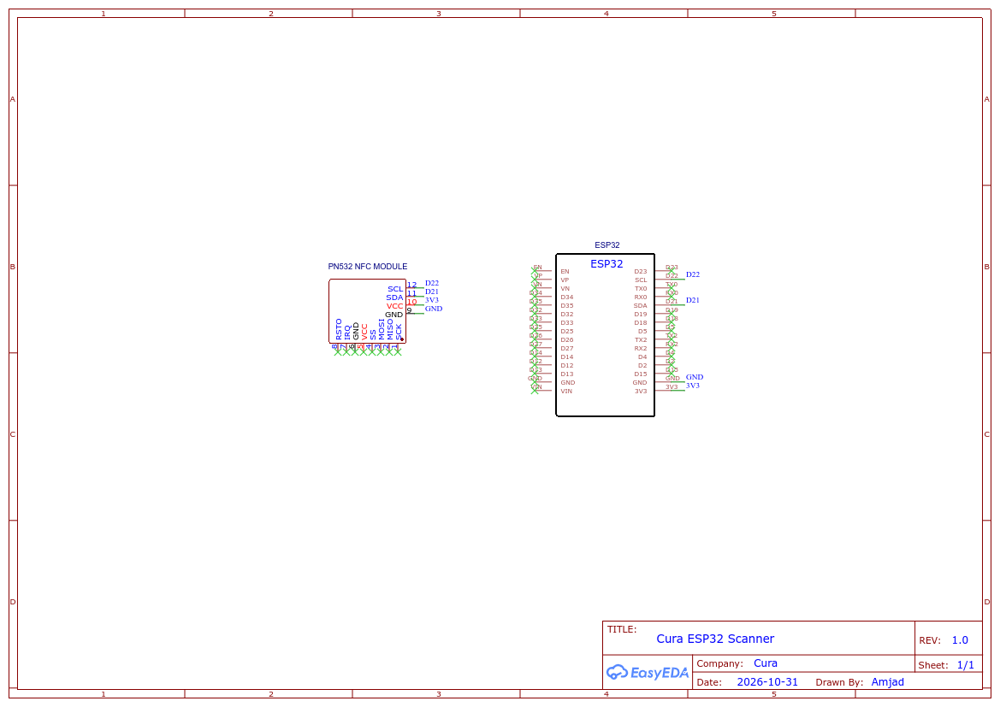

# 🔌 Hardware Pinout & Wiring Specification

> Detailed electrical wiring, pin mappings, and schematic reference for the ESP32-S3 + PN532 NFC reader/writer.

## 📑 Language Options / Pilihan Bahasa
* 🇬🇧 **[English Documentation (Current)](PINOUT_AND_WIRING.md)**
* 🇲🇾 **[Dokumentasi Bahasa Melayu](PINOUT_AND_WIRING_MY.md)**

---

## 📐 Circuit Schematic Diagram

<p align="center">
  
</p>

* 📄 **Download Printable Vector PDF:** [`../Schematic_cura_2026-10-31.pdf`](../Schematic_cura_2026-10-31.pdf)

---

## 📌 Complete Electrical Pin Mapping

| ESP32-S3 MCU Pin | PN532 Module Pin | Functional Signal | Electrical Specification | Wire Color (Rec.) |
|:----------------:|:----------------:|:------------------|:-------------------------|:-----------------:|
| **GPIO 8** | `SDA` | I2C Serial Data | 3.3V Logic Level (Internal Pull-Up enabled) | Blue |
| **GPIO 9** | `SCL` | I2C Serial Clock | 3.3V Logic Level (Internal Pull-Up enabled) | Yellow |
| **GPIO 4** | `IRQ` | Hardware Interrupt Request | Active-Low Digital Input | Green |
| **GPIO 5** | `RST0` / `RST` | Module Reset Line | Active-Low Digital Output | Orange |
| **3.3V** | `VCC` | Regulated DC Power | 3.3V DC (Draws up to 150mA during RF TX) | Red |
| **GND** | `GND` | Digital Ground | 0V Common Reference | Black |
| **GPIO 19** | Type-C D- | USB Differential Data (-) | USB 2.0 Full Speed (Native Peripheral) | Internal |
| **GPIO 20** | Type-C D+ | USB Differential Data (+) | USB 2.0 Full Speed (Native Peripheral) | Internal |

---

## ⚙️ PN532 Module DIP Switch Configuration

The Adafruit / Elechouse PN532 board supports three bus protocols: HSU (UART), SPI, and I2C. The Cura firmware strictly requires **I2C mode**:

```text
    ┌──────────┐
    │  1    2  │
    │ [■]  [ ] │  SEL0 = 1 (ON / HIGH)
    │ [ ]  [■] │  SEL1 = 0 (OFF / LOW)
    └──────────┘
```

| Switch Label | State | Voltage Level |
|:------------:|:-----:|:-------------:|
| **SEL0** | **1 (ON)** | 3.3V High |
| **SEL1** | **0 (OFF)** | 0V Low |

---

## ⚡ Electrical & Power Safety Rules

1. **Power Rail Decoupling:**
   - The PN532 high-frequency antenna draws transient current spikes up to 150mA when establishing inductive coupling with NFC tags.
   - Power the module from the ESP32-S3 onboard **3.3V LDO regulator** pin, or directly from the 5V USB rail if the module contains an onboard 3.3V low-dropout regulator.
2. **Logic Voltage Safety:**
   - ESP32-S3 GPIO pins are **not 5V tolerant**. Ensure the PN532 is operated at 3.3V logic to protect GPIO 4, 5, 8, and 9 from overvoltage breakdown.
3. **Short Cable Lengths:**
   - Keep I2C jumper wires under **15 cm** (6 inches) to prevent clock capacitive degradation and packet corruption at 400 kHz bus speeds.

---

## 📜 License
* Developed for **Educational Purposes Only**.
