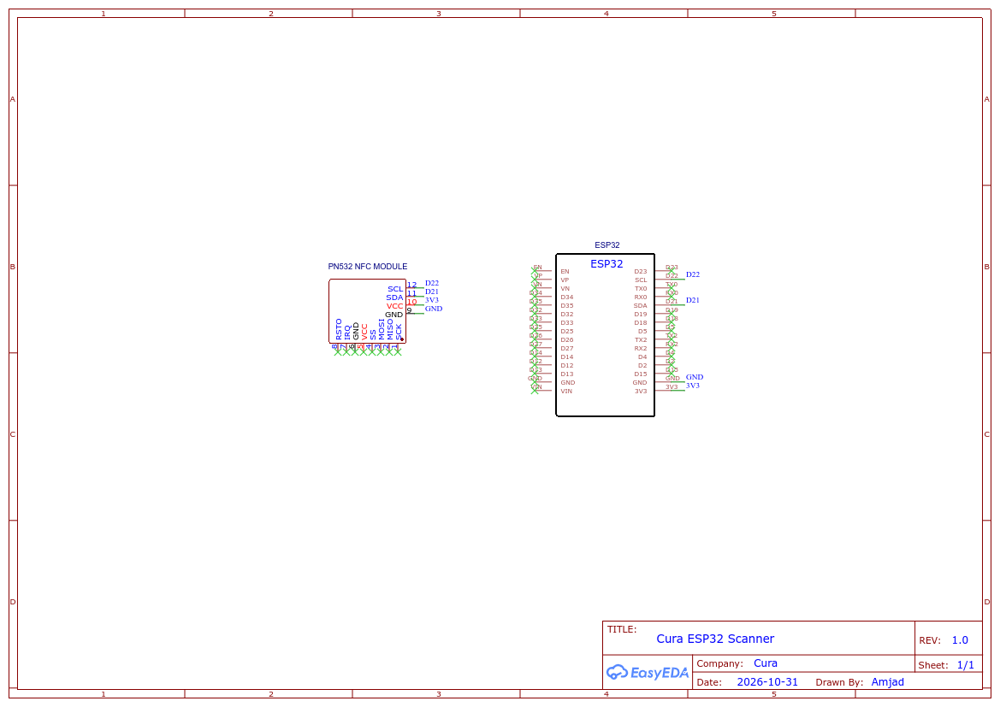

# 🔌 Spesifikasi Sambungan Pin & Pendawaian Perkakasan

> Keterangan lengkap sambungan litar elektrik, pemetaan pin, dan rujukan skematik untuk pembaca/penulis NFC ESP32-S3 + PN532.

## 📑 Pilihan Bahasa / Language Options
* 🇲🇾 **[Dokumentasi Bahasa Melayu (Semasa)](PINOUT_AND_WIRING_MY.md)**
* 🇬🇧 **[English Documentation](PINOUT_AND_WIRING.md)**

---

## 📐 Gambar Rajah Skematik Litar

<p align="center">
  
</p>

* 📄 **Muat Turun PDF Skematik Vektor Berkualiti Tinggi:** [`../Schematic_cura_2026-10-31.pdf`](../Schematic_cura_2026-10-31.pdf)

---

## 📌 Pemetaan Lengkap Pin Elektrik

| Pin MCU ESP32-S3 | Pin Modul PN532 | Isyarat Fungsian | Spesifikasi Elektrik | Cadangan Warna Wayar |
|:----------------:|:---------------:|:-----------------|:---------------------|:--------------------:|
| **GPIO 8** | `SDA` | Data Bersiri I2C | Paras Logik 3.3V (Pull-Up Dalaman Aktif) | Biru |
| **GPIO 9** | `SCL` | Jam Bersiri I2C | Paras Logik 3.3V (Pull-Up Dalaman Aktif) | Kuning |
| **GPIO 4** | `IRQ` | Permintaan Gangguan Perkakasan | Input Digital Aktif-Rendah (Active-Low) | Hijau |
| **GPIO 5** | `RST0` / `RST` | Talian Reset Modul | Output Digital Aktif-Rendah | Jingga |
| **3.3V** | `VCC` | Kuasa DC Terkawal | 3.3V DC (Mengambil arus hingga 150mA semasa pancaran RF) | Merah |
| **GND** | `GND` | Ground Digital | Rujukan Sepunya 0V | Hitam |
| **GPIO 19** | Type-C D- | Data Pembezaan USB (-) | USB 2.0 Kelajuan Penuh (Perkakasan Asli) | Dalaman Papan |
| **GPIO 20** | Type-C D+ | Data Pembezaan USB (+) | USB 2.0 Kelajuan Penuh (Perkakasan Asli) | Dalaman Papan |

---

## ⚙️ Konfigurasi Suis DIP Modul PN532

Modul Adafruit / Elechouse PN532 menyokong tiga protokol komunikasi: HSU (UART), SPI, dan I2C. Firmware Cura memerlukan **Mod I2C**:

```text
    ┌──────────┐
    │  1    2  │
    │ [■]  [ ] │  SEL0 = 1 (ON / TINGGI)
    │ [ ]  [■] │  SEL1 = 0 (OFF / RENDAH)
    └──────────┘
```

| Label Suis | Keadaan | Paras Voltan |
|:----------:|:-------:|:------------:|
| **SEL0** | **1 (ON)** | 3.3V Tinggi |
| **SEL1** | **0 (OFF)** | 0V Rendah |

---

## ⚡ Peraturan Keselamatan Elektrik & Kuasa

1. **Pengasingan Rel Kuasa (Decoupling):**
   - Antena frekuensi tinggi 13.56MHz PN532 menghasilkan lonjakan arus sehingga 150mA apabila mengesan dan membaca tag NFC secara aruhan magnetik.
   - Sambungkan bekalan kuasa modul ke pin **pengatur voltan 3.3V LDO** pada papan ESP32-S3, atau talian 5V jika modul PN532 anda mempunyai regulator 3.3V terbina.
2. **Keselamatan Voltan Logik:**
   - Pin GPIO pada ESP32-S3 **tidak bertoleransi terhadap voltan 5V (Not 5V Tolerant)**. Pastikan paras logik PN532 kekal pada 3.3V untuk mengelakkan kerosakan pada GPIO 4, 5, 8, dan 9.
3. **Panjang Wayar Pendek:**
   - Pastikan panjang wayar pelompat I2C **di bawah 15 cm** bagi mengelakkan herotan kapasitif pada isyarat jam (SCL) dan rasuah paket data pada kelajuan bas 400 kHz.

---

## 📜 Lesen
* Dibangunkan untuk **Tujuan Pembelajaran Sahaja** (Educational Purposes Only).
